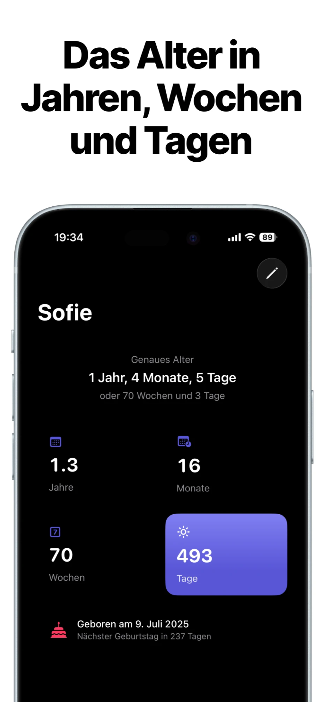
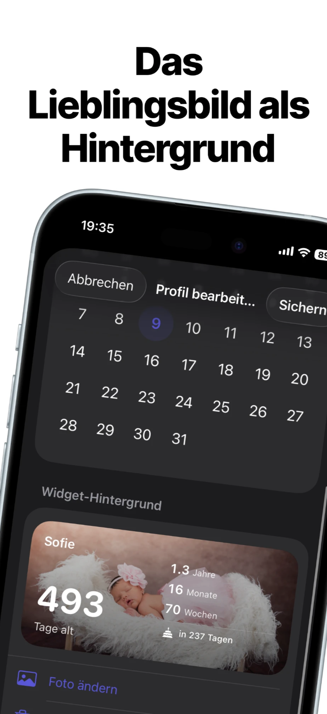
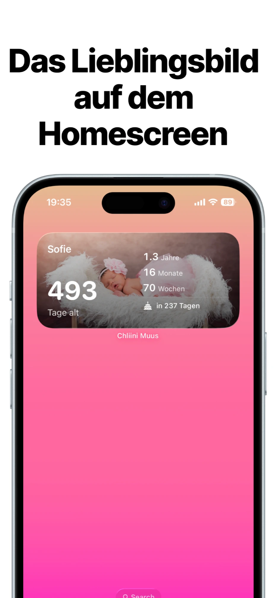

# Chliini Muus

An iOS app and widget that show how old someone is, counted in days. It's built for tracking a baby's or child's age. "Chliini Muus" is Swiss German for "little mouse".

Enter a name and a birth date. The app then shows the person's age:

- exactly, in years, months and days
- as totals: years (with one decimal place), months, weeks and days
- with the number of days until the next birthday

The app's interface is in German.

  
  
  

## Widget

The "Alter in Tagen" widget is available in these sizes:

- **Home Screen:** small and medium
- **Lock Screen:** circular, rectangular and inline

The day count updates at midnight. You can pick a photo as the widget background in the app's settings. A live preview there shows how the widget will look.

## Project structure

| Folder | Contents |
| --- | --- |
| `ChliiniMuus/` | The app: SwiftUI views, settings screen and assets |
| `ChliiniMuusWidget/` | The WidgetKit extension: timeline provider and widget setup |
| `Shared/` | Code used by both targets: age calculation, profile and photo storage, widget layout |
| `Config/` | Entitlements and the widget's Info.plist |
| `AppStore/` | Screenshots and icons for the App Store |

The app and the widget share data through the App Group `group.ch.appic.chliinimuus`:

- the name and birth date are stored in `UserDefaults`
- the background photo is saved as a downscaled JPEG

## Requirements

- iOS 17.0 or later
- Xcode with Swift 5. There are no third-party dependencies.

## Building

1. Open `ChliiniMuus.xcodeproj` in Xcode.
2. Select your development team.
3. Run the `ChliiniMuus` scheme.

To build with your own team, change the bundle identifiers (`ch.appic.chliinimuus`, `ch.appic.chliinimuus.widget`) and the App Group in `Config/*.entitlements` and `Shared/ProfileStore.swift`.
